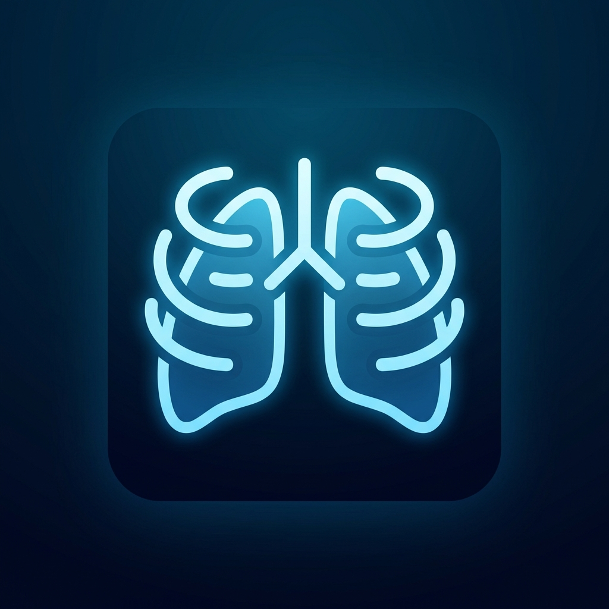
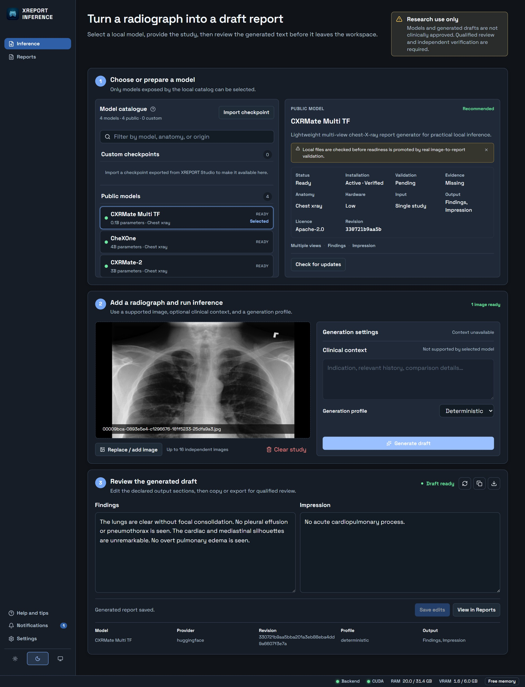
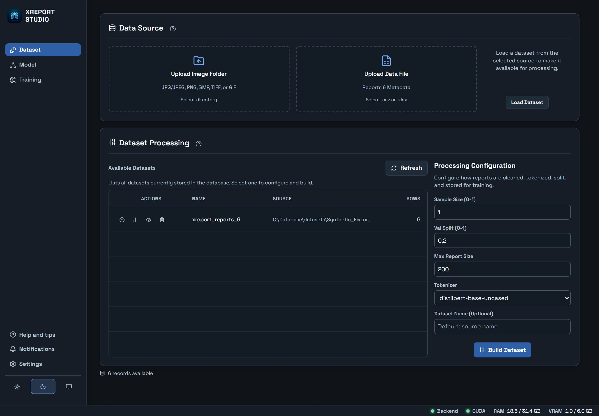
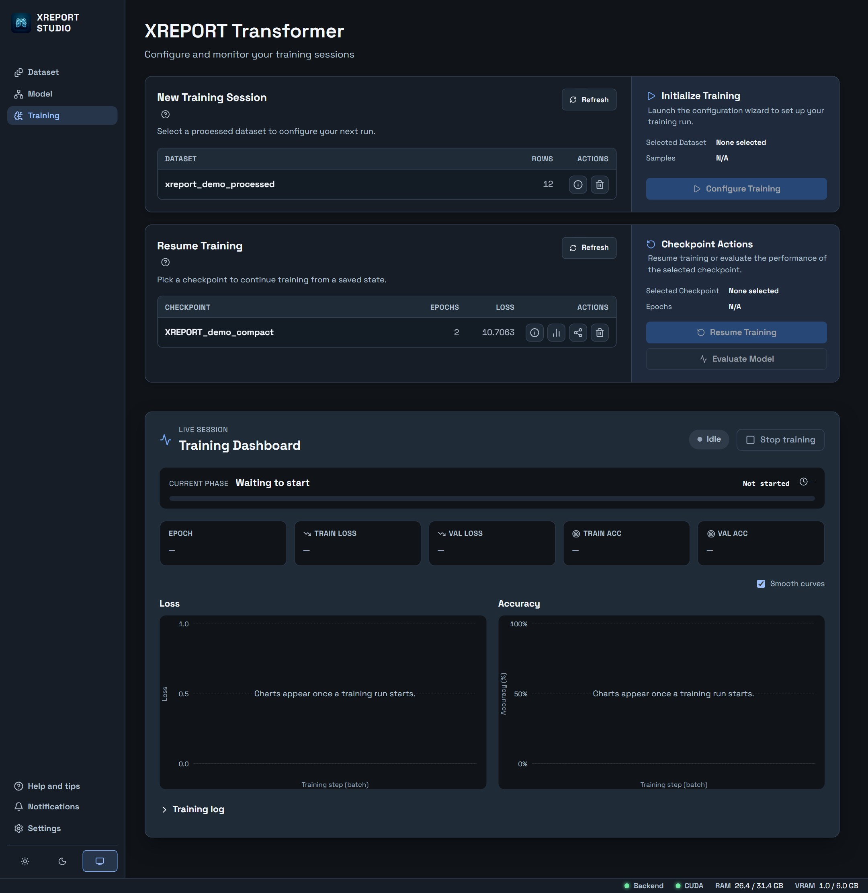

<p align="center"></p>

<h1 align="center">XREPORT</h1>

<p align="center">A local research suite for generating, reviewing, and training radiological report models.</p>

<p align="center">
  <a href="#xreport-inference">Inference</a> ·
  <a href="#xreport-studio">Studio</a> ·
  <a href="#configuration">Configuration</a> ·
  <a href="assets/docs/project_index.md">Documentation</a>
</p>

<p align="center"></p>

XREPORT contains **two separate applications**:

| Application | Purpose | Distribution |
| --- | --- | --- |
| **XREPORT Inference** | Generate and review draft reports with public models or imported checkpoints. | Windows desktop package, or from source |
| **XREPORT Studio** | Prepare datasets, then train and evaluate models. Exports checkpoints for Inference. | From source |

The applications have separate environments and data folders. Inference works without Studio; you need Studio only to prepare data or train your own model. Only Inference is packaged and released: the Windows packages on GitHub Releases contain Inference alone, and installing them does not install Studio. Studio is run from a repository checkout. See the [changelog](CHANGELOG.md) for what changed in each release.

> **Research use only.** XREPORT and its models are not clinically approved. Generated text can omit findings or contain plausible errors. A qualified reviewer must check every draft against the source images and relevant context.

## XREPORT Inference

Use Inference to select a model, add supported images, generate a draft, and review its output. The model catalogue shows each model's input requirements, output sections, installation state, and revision. You can edit, save, copy, or export a report; saved reports retain the original output and generation metadata.

Public model weights may require a first download, and some models require provider approval and credentials. Anatomy, image limits, hardware needs, and access terms vary; consult the catalogue and [model documentation](assets/docs/runtime/local_inference_models.md). Metrics and successful generation do not establish clinical accuracy.

### Start Inference

On Windows, download a CPU or CUDA portable executable or MSI from [GitHub Releases](https://github.com/CTCycle/XREPORT-radiological-reports-generator/releases), when available. The CUDA package requires a supported NVIDIA GPU and driver; the portable executable requires Microsoft WebView2.

To run from source, clone the repository and run this command in PowerShell from the repository root:

```powershell
powershell -ExecutionPolicy Bypass -File .\start_on_windows.ps1 -Action Launch
```

The launcher prepares dependencies, initializes the database, builds the frontend when needed, and opens Inference at `http://127.0.0.1:5003` by default. First launch can take several minutes. Keep the launcher open while using the app; press **Ctrl+C** to stop it.

### Generate a draft

1. Select a model and check its anatomy, image limit, output sections, and access requirements.
2. Add authorized, de-identified images and choose a generation profile. The app can download an uncached public model on the first generation.
3. Generate the draft, review the text and metadata, and correct or discard unsupported statements. Save edits before leaving the page.

## XREPORT Studio

Use Studio to build and evaluate models. Import an image folder and a report table, review matched and unmatched records, and process the dataset for training. You can start or resume training, monitor jobs, and evaluate checkpoints against their associated processed datasets.

<p align="center"></p>

<p align="center"></p>

The screenshots show the Dataset and Training pages with a small test dataset and checkpoint; the training dashboard is idle.

### Start Studio

Studio runs from source. From the repository root on Windows, run:

```powershell
powershell -ExecutionPolicy Bypass -File .\start_on_windows.ps1 -Action LaunchStudio
```

Studio has its own Python environment and data folder. Its first launch installs the selected CPU or CUDA profile; an unattended first launch defaults to CPU. Keep the launcher open while using Studio and press **Ctrl+C** to stop it.

See [Getting started](assets/docs/operations/getting_started.md) for profile selection and the manual macOS/Linux development setup. The [core workflows](assets/docs/operations/workflows.md) cover dataset preparation and training in more detail.

## Move a model from Studio to Inference

In Studio, choose **Export for XREPORT** on the Training page to create an `.xreportckpt` archive. In Inference, choose **Import checkpoint** in the model catalogue. This transfers the model checkpoint, not the Studio dataset or the applications' other data. See [checkpoint exchange](assets/docs/architecture/applications_and_checkpoint_exchange.md) for details.

## Configuration

The Windows launcher creates `settings/.env` from [the example](settings/.env.example) if it is absent. The default source-mode resource directory is `data`; `XREPORT_RESOURCES_DIR` changes its location. Set `HF_TOKEN` only when a gated Hugging Face model requires credentials. Model downloads need network access and disk space. Back up datasets and checkpoints before removing application data.

See [runtime configuration](assets/docs/runtime/configuration.md) for the full set of options and [troubleshooting](assets/docs/operations/troubleshooting.md) for startup and database issues.

## Development

The source application uses Python and FastAPI for the backend, Angular for the frontend, and SQLite by default. Windows desktop releases use Tauri. Python 3.14 or newer is required for the backend; the Windows launcher prepares its own runtimes.

The [project documentation index](assets/docs/project_index.md) links to architecture, startup, testing, and operational guides. The Windows test runner is `app\tests\run_tests.bat`; its options and manual commands are described in [startup and testing](assets/docs/runtime/startup.md).

## Contributing

Issues and pull requests are welcome. Describe the problem and keep changes focused; the [testing and quality guide](assets/docs/coding/testing_and_quality.md) covers the project's conventions.

## License

[MIT](LICENSE)
