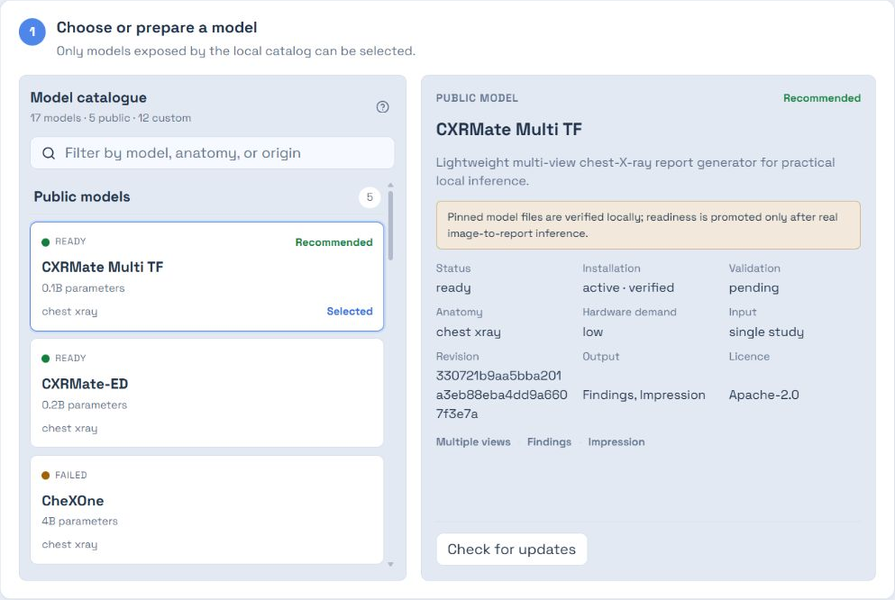
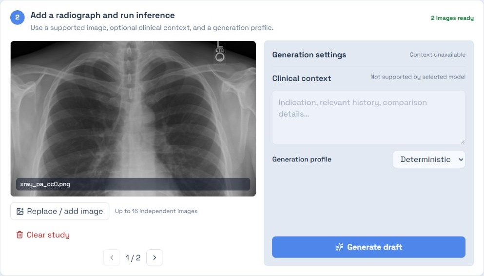
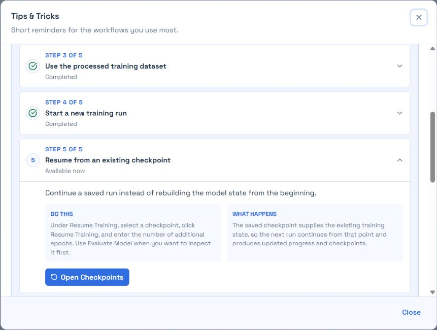

<p align="center"></p>

# XREPORT Radiological Reports Generator

**A local-first research app for preparing imaging datasets, training and evaluating models, and reviewing draft radiology reports.**

[](https://github.com/CTCycle/XREPORT-radiological-reports-generator/stargazers) [](https://github.com/CTCycle/XREPORT-radiological-reports-generator/commits) [](https://github.com/CTCycle/XREPORT-radiological-reports-generator/releases) [](LICENSE)

[](https://www.python.org/) [](https://angular.dev) [](https://www.microsoft.com/windows)

## Overview

XREPORT is a local-first research application for importing image and report datasets, training and evaluating models, and generating editable draft radiology reports from X-ray images. It guides users from dataset preparation through model training, checkpoint evaluation, and report generation in a single workflow. Generated reports are unverified drafts with model and output metadata, intended for review against source images rather than clinical use. The application runs a FastAPI backend with an Angular frontend, persists state in SQLite, and supports optional Windows desktop packages. Public models may need network access and storage on first download, while gated models require provider access and credentials. It is research use only and is not a diagnostic device or a clinically approved reporting system.

> **Research use only.** XREPORT is not a diagnostic device or a clinically approved reporting system. Models may omit findings or generate plausible but incorrect text. Review every draft against the source images and relevant context before use.

## Key Features

- In XREPORT Studio: import images and report tables, review matched and unmatched records, prepare datasets, run local training, resume checkpoints, and evaluate saved models with quality metrics.
- Move trained checkpoints from Studio to XREPORT through a portable, verified archive.
- Select a model, generate a draft from de-identified images within model-specific image limits, and review editable report sections.
- Inspect model anatomy, image limits, readiness, resource needs, access requirements, and output contracts in the model catalogue.
- Track long-running jobs with progress, cancellation, and typed failure handling.
- Use only authorized, de-identified data and back up datasets and checkpoints before changes.
- Generate reports with provenance and metadata for qualified review.
- Use optional Windows CPU and CUDA desktop packages with a Tauri shell.

Public models may need an internet connection and additional storage for their first download. Gated models can require provider access and credentials. Model metrics and technical checks do not establish clinical accuracy or safety.

## Screenshots

These images show representative interface workflows. They are not clinical or model-quality evidence.

<p align="center">
  <kbd></kbd>
  <kbd></kbd>
</p>
<p align="center"><sub>Dataset image viewer (left) and checkpoint evaluation report (right).</sub></p>

<p align="center">
  <kbd></kbd>
  <kbd></kbd>
</p>
<p align="center"><sub>Inference draft review (left) and inference view (right).</sub></p>

<p align="center">
  <kbd></kbd>
  <kbd></kbd>
</p>
<p align="center"><sub>Inference workflow (left) and help and tips (right).</sub></p>

## Technology Stack

| Layer | Technology | Version |
|---|---|---|
| Backend | Python, FastAPI | 3.14+ |
| Frontend | Angular | 22 |
| Frontend tooling | Node.js | 22.22.3 |
| Desktop shell | Tauri | 2 |
| Database | SQLite (embedded) | - |

## Installation and Usage

On Windows, run the launcher from the repository root:

```powershell
powershell -ExecutionPolicy Bypass -File .\start_on_windows.ps1 -Action Launch
```

The launcher prepares local runtimes and dependencies as needed, initializes the database, builds the frontend when its output is missing or stale, and opens the local application when ready. FastAPI serves the built frontend and API from the same origin; the launcher stays open until you press Ctrl+C to stop the backend cleanly. First launch can take several minutes. For manual macOS/Linux development setup, see [Getting started](assets/docs/operations/getting_started.md).

XREPORT is split into two local applications. **XREPORT** (inference, report review, model import) is the application above and the only one shipped as a package. **XREPORT Studio** (dataset preparation, validation, training, evaluation, checkpoint export) runs from source on its own port and data folder:

```powershell
powershell -ExecutionPolicy Bypass -File .\start_on_windows.ps1 -Action LaunchStudio
```

Export a trained model from Studio with *Export for XREPORT* on the Training page, then use *Import checkpoint* in XREPORT's model catalogue. The archive (`.xreportckpt`) works across computers and with the packaged builds. Existing datasets and checkpoints can be copied into Studio with `-Action MigrateToStudio` (use `-DryRun` first); nothing is deleted. See [applications and checkpoint exchange](assets/docs/architecture/applications_and_checkpoint_exchange.md).

Windows CPU and CUDA portable or MSI packages are listed on [GitHub Releases](https://github.com/CTCycle/XREPORT-radiological-reports-generator/releases) when available. CUDA requires supported NVIDIA hardware and drivers. Portable packages require Microsoft WebView2.

## Configuration

Source-mode settings live in `settings/.env`, which the launcher creates from `settings/.env.example` when absent. Defaults bind the normal browser/API origin to `127.0.0.1:5003`; `UI_HOST` and `UI_PORT` configure Angular and Tauri development workflows. The app uses the `data` directory with embedded SQLite. Set `XREPORT_RESOURCES_DIR` to use another source-mode resource root. `HF_TOKEN` is needed only for gated Hugging Face models that require access credentials.

Use only data you are authorized to process, and de-identify images and reports before import. Back up important datasets and checkpoints before resetting or removing application data. Treat every generated report as an unverified draft: compare it with the source images and relevant context, then correct or discard unsupported statements under the appropriate review process.

| Variable | Purpose | Default |
|---|---|---|
| `XREPORT_RESOURCES_DIR` | Source-mode resource root | `data` |
| `HF_TOKEN` | Credentials for gated Hugging Face models | (none) |
| `UI_HOST` | Angular and Tauri development host | - |
| `UI_PORT` | Angular and Tauri development port | - |

## Documentation

- [Core workflows](assets/docs/operations/workflows.md) - dataset, training, inference, and validation journeys.
- [Troubleshooting](assets/docs/operations/troubleshooting.md) - startup, database, and common runtime issues.
- [Runtime configuration](assets/docs/runtime/configuration.md) and [local inference models](assets/docs/runtime/local_inference_models.md).

## Limitations

- Research use only. XREPORT is not a diagnostic device or a clinically approved reporting system.
- Models may omit findings or generate plausible but incorrect text. Model metrics and technical checks do not establish clinical accuracy or safety.
- Public models may need an internet connection and additional storage for their first download. Gated models can require provider access and credentials.
- Generated reports are unverified drafts and must be reviewed against the source images and relevant context.
- Only data you are authorized to process should be imported, and images and reports must be de-identified before import.

## Contributing

Contributions are welcome. Open an issue or pull request with a clear description of the change and its motivation. Keep changes focused and consistent with the existing code style.

## License

Licensed under the MIT License. See [LICENSE](LICENSE).
