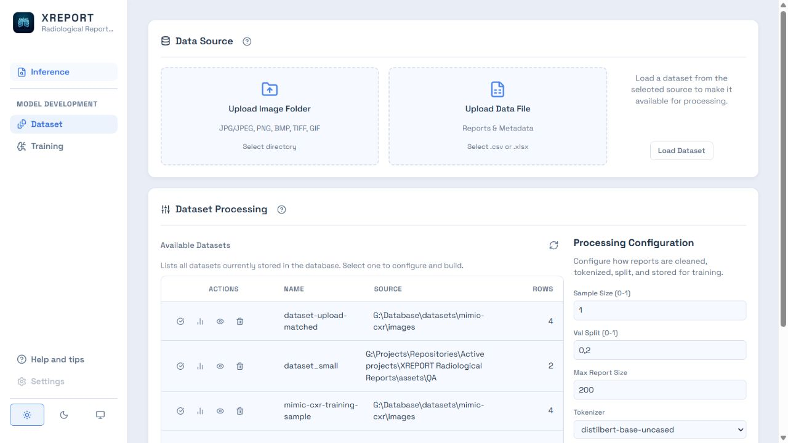
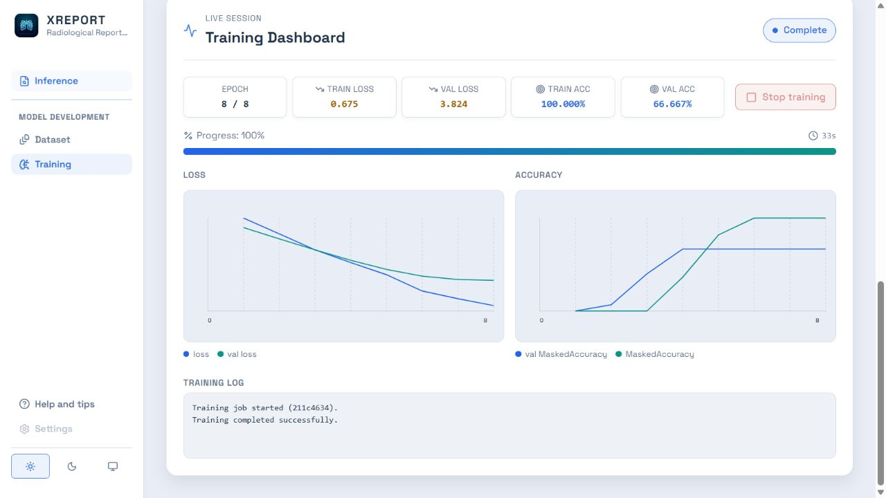
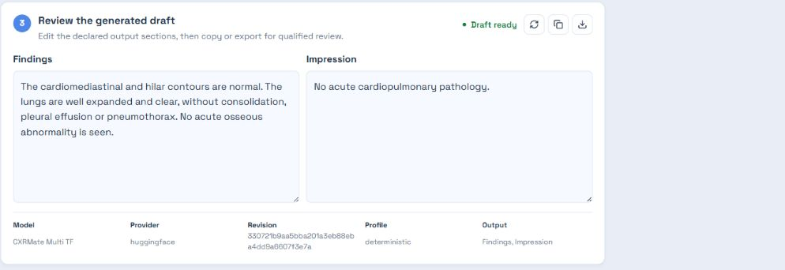

<p align="center"></p>

# XREPORT Radiological Reports Generator

**A local-first research app for preparing imaging datasets, training and evaluating models, and reviewing draft radiology reports.**

[](LICENSE) [](https://github.com/CTCycle/XREPORT-radiological-reports-generator/releases) [](https://github.com/CTCycle/XREPORT-radiological-reports-generator/actions/workflows/ci.yml?query=branch%3Adevelop) [](https://www.python.org/) [](https://nodejs.org/) [](https://angular.dev)

## Overview

XREPORT is a local-first research application for importing image and report datasets, running local model training or evaluation, and generating editable draft reports from X-ray images.

> **Research use only.** XREPORT is not a diagnostic device or a clinically approved reporting system. Models may omit findings or generate plausible but incorrect text. Review every draft against the source images and relevant context before use.

## Key Features

- Import images and report tables, review record matches, and prepare datasets.
- Train local models, resume checkpoints, and evaluate saved models.
- Select a ready model, generate a draft from de-identified images, and review editable sections with model and output metadata.
- Inspect model anatomy, image limits, readiness, resource needs, access requirements, and output contracts in the model catalogue.

Public models may need an internet connection and additional storage for their first download. Gated models can require provider access and credentials. Model metrics and technical checks do not establish clinical accuracy or safety.

## Screenshots

These images show representative interface workflows. They are not clinical or model-quality evidence.







## Technology Stack

- Python 3.14 or later with FastAPI for the local backend.
- Node.js 22.22.3 and Angular 22 for the frontend.
- Tauri 2 supports optional Windows CPU and CUDA desktop packages.

## Installation and Usage

On Windows, run the launcher from the repository root:

```powershell
powershell -ExecutionPolicy Bypass -File .\start_on_windows.ps1 -Action Launch
```

The launcher prepares local runtimes and dependencies as needed, initializes the database, builds the frontend when its output is missing or stale, and opens the local application when ready. FastAPI serves the built frontend and API from the same origin; the launcher stays open until you press Ctrl+C to stop the backend cleanly. First launch can take several minutes. For manual macOS/Linux development setup, see [Getting started](assets/docs/operations/getting_started.md).

Windows CPU and CUDA portable or MSI packages are listed on [GitHub Releases](https://github.com/CTCycle/XREPORT-radiological-reports-generator/releases) when available. CUDA requires supported NVIDIA hardware and drivers. Portable packages require Microsoft WebView2.

## Configuration

Source-mode settings live in `settings/.env`, which the launcher creates from `settings/.env.example` when absent. Defaults bind the normal browser/API origin to `127.0.0.1:5003`; `UI_HOST` and `UI_PORT` configure Angular and Tauri development workflows. The app uses the `data` directory with embedded SQLite. Set `XREPORT_RESOURCES_DIR` to use another source-mode resource root. `HF_TOKEN` is needed only for gated Hugging Face models that require access credentials.

Use only data you are authorized to process, and de-identify images and reports before import. Back up important datasets and checkpoints before resetting or removing application data. Treat every generated report as an unverified draft: compare it with the source images and relevant context, then correct or discard unsupported statements under the appropriate review process.

## Documentation

- [Core workflows](assets/docs/operations/workflows.md) — dataset, training, inference, and validation journeys.
- [Troubleshooting](assets/docs/operations/troubleshooting.md) — startup, database, and common runtime issues.
- [Runtime configuration](assets/docs/runtime/configuration.md) and [local inference models](assets/docs/runtime/local_inference_models.md).

## License

Licensed under the MIT License. See [LICENSE](LICENSE).
