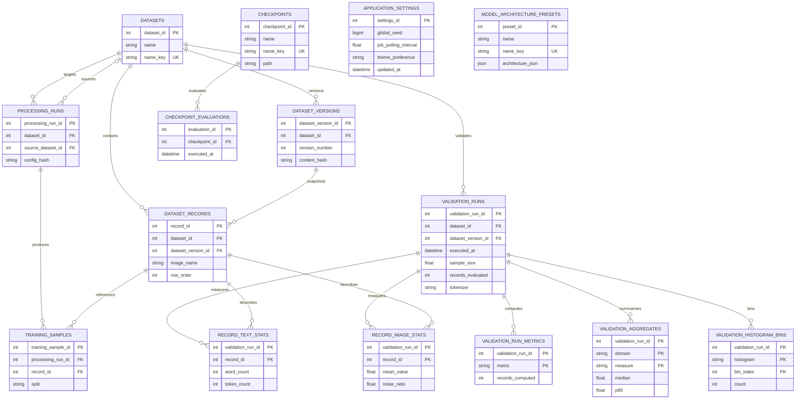
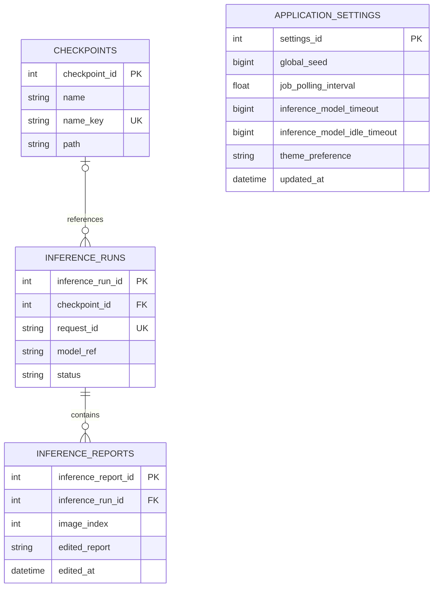

# XREPORT Persistence

Last updated: 2026-10-28

XREPORT Inference and XREPORT Studio each own a separate database with its own
schema, migration stream, and settings row. Neither application opens, migrates,
or writes the other's database; `.xreportckpt` files are their only exchange.

## Database Backend Selection

The sources of truth are deliberately separated:

- `settings/.env` owns deployment values such as runtime host, ports, API proxy,
  CORS, inference process policy, and resource root. It contains no database
  configuration.
- `<resource root>/database-config.json` owns only the selected database
  backend and its connection parameters. It is independent of the database;
  PostgreSQL passwords are DPAPI-protected for the current Windows account.
- The singleton `application_settings` database row owns only mutable
  user-facing application behavior. Both applications store the global seed,
  job polling interval, and theme preference; only XREPORT Inference stores the
  inference timeout, idle timeout, and generation limits. Studio's Settings API
  returns `inference: null` and rejects inference patches.
- `app/xreport_inference/configurations/inference_models.py` owns the immutable, reviewed
  inference catalogue and its safety/runtime contract.

From `settings/.env`:

- `XREPORT_RESOURCES_DIR` optionally changes the resource root. It defaults to `data`; relative values are resolved from the repository root.

The Settings → Database section supports SQLite and PostgreSQL (psycopg 3).
SQLite paths, PostgreSQL connection/authentication fields, SSL options, timeout,
and insert batch size are stored in each application's own
`database-config.json` (`<resources>/` for XREPORT Inference,
`<resources>/studio/` for Studio). All application settings and records remain
in the currently selected database. The Database section also reports which
application's schema it manages and the current and target schema revisions.

## Initialization And Compatibility

Backend startup calls the startup service, which coordinates database preparation and resource validation before serving requests.

Runtime switching pauses and drains API requests and refuses to switch while a
background job is active. The target connection and schema are prepared before
activation; a failed activation restores the previous connection and leaves the
previous configuration in effect. Existing repository objects keep the shared
database facade, whose connection pool is replaced in place. The UI receives
application settings read from the newly active database. No records or
settings are copied between databases. Missing or invalid startup configuration
opens restricted Database recovery UI while normal application routes remain
unavailable.

When the dedicated database configuration file is absent, startup creates a
default SQLite configuration pointing at the resource root's database file.
Stray `EMBEDDED_DATABASE`/`DATABASE_*` values in `.env` or the process
environment are neither read into configuration nor loaded into `os.environ`.
`DATABASE_URL` is not supported. A corrupt dedicated file is preserved for
recovery rather than replaced from an old environment source. Changing
process-level launch settings such as the resource root requires a restart;
database switching does not.

Alembic is the authoritative schema history, with one independent stream per
application:

| Application | ORM base | Migration stream | Version table | Head |
|---|---|---|---|---|
| XREPORT Inference | `xreport_inference/repositories/schemas/inference.py` (`InferenceBase`) | `xreport_inference/migrations/inference` | `xreport_inference_version` | `36d142391099` |
| XREPORT Studio | `xreport_studio/repositories/schemas/studio.py` (`StudioBase`) | `xreport_studio/migrations/studio` | `xreport_studio_version` | `d1f4b7c20a53` |

`xreport_shared/repositories/database/schema.py` binds the running profile (`XREPORT_APP`) to
the schema its application package registered when it was imported
(`register_application_schema`); the shared package never imports an application. Each baseline creates its schema and seeds its
`application_settings` singleton. `app/server/alembic.ini` has `[inference]`
and `[studio]` sections (`alembic -n studio ...`); the CLI only targets the
database of the matching `XREPORT_APP` profile unless `sqlalchemy.url` is set.
The PostgreSQL migration advisory lock includes the profile.

Ownership guard: before migrating, startup and the Settings probe reject a
database that holds the other application's version table ("This database
belongs to XREPORT Studio") or the retired shared `alembic_version` table from
releases up to 3.3.1. Such databases are never modified; choose a separate
database or recreate it. There is no conversion from the retired shared
schema, and re-creating starts with typed defaults and an empty checkpoint
registry. A database revision unknown to the application's stream is rejected
the same way.

The `generated_report` column of `inference_reports` remains the immutable
model output; a nullable `edited_report`/`edited_at` pair stores a user draft
separately and the effective draft is resolved at read time. Saving text equal
to the generated output clears the edit override, and deleting an inference
run cascades to its report rows.

The `application_settings` row owns a nullable database-backed theme
preference. A `NULL` value means `system`; the Settings API and theme selector
read and write it directly.

### SQLite

- A missing database file is created by SQLAlchemy and upgraded from Alembic base to head.
- Startup acquires an exclusive SQLite transaction before checking or applying migrations, so concurrent processes serialize safely.
- A non-empty database without the application's version table is rejected. Existing data is
  never silently stamped, rewritten, or inferred as a compatible legacy schema;
  use the explicit migration/initialization workflow after reviewing the
  database state.
- The migration stream seeds the singleton application-settings row with typed
  defaults. A database re-creation starts with an empty checkpoint registry;
  new checkpoint folders are registered when training completes, not by
  scanning the artifact directory.
- Partial, modified, unexpected, or older-revision schemas fail without repair
  or stamping; re-initialization requires deleting or replacing the database
  file. Migration failures roll back the shared transaction.

### PostgreSQL

- Initialization and startup create the configured database through the administrative connection when it does not exist and the configured role has permission.
- Database creation and migration use bounded PostgreSQL advisory locks. Migrations run on one transaction-scoped connection and preserve existing data.
- A missing/unknown revision, multiple heads, incompatible legacy schema, unavailable database, or insufficient creation privilege fails startup with actionable sanitized logging.

`Base.metadata` is the target metadata used for reviewed autogeneration and drift checks. It is not used to create or evolve production schemas after Alembic is introduced.

If `settings/.env` is missing, it is copied from `settings/.env.example`; an existing environment file is never overwritten. Additional startup validation ensures required resource directories exist.

## Persisted Entity Model

### XREPORT Studio

`model_architecture_presets` (revision `8071b092e5f8`) stores custom model
architecture presets and has no foreign keys: a training run copies the
resolved architecture into its checkpoint configuration, so deleting or
editing a preset never affects existing checkpoints.
`hidden_architecture_presets` (revision `b3c1d5a7e9f2`) lists built-in preset
keys the user removed from the preset list.

### Validation statistics (revision `c7e2a94f1b08`)

A validation run is immutable: repeated runs are kept as history and nothing is
overwritten. `validation_runs` stores the configuration (sample fraction, seed,
sampled and evaluated record counts, vocabulary size, optional tokenizer and
`config_json` for auxiliary options); the computed values are relational:

- `validation_run_metrics`: which metrics ran and on how many records.
- `record_text_stats` / `record_image_stats`: one row per record and run
  (`(validation_run_id, record_id)` primary key, indexed by `record_id`) for
  SQL comparisons across datasets and records. Unreadable images and missing
  values produce no row or a NULL, never a zero.
- `validation_aggregates`: count, total, min, max, mean, median, std, P5, P25,
  P75, P95 per `(run, domain, measure)`; domains `text`, `image`, `token`.
- `validation_histogram_bins`: pixel-intensity and report-length bins.

The migration backfills runs written before it (aggregate means, min/max and
the pixel histogram; distribution values that were never stored stay NULL) and
drops the former JSON and flat aggregate columns; `downgrade` restores them.
Revision `d1f4b7c20a53` adds the tokenizer revision and the pad/start/end token
ids to `processing_runs`; they are part of the processing hash, so changing the
tokenizer, its revision or the split seed never reuses cached token sequences.
Reports are served by `GET /api/validation/runs/{dataset}`, `.../{run_id}` and
`.../{run_id}/records` (sortable, filterable, paged).

### XREPORT Inference

The tables below are owned by independent repositories:

- `DatasetRepository` (Studio): datasets, dataset versions, records, processing runs, and training samples.
- `ValidationRepository` (Studio): validation runs and checkpoint evaluations.
- `InferenceRepository` (Inference): inference runs and generated reports.
- `CheckpointRepository` (both, each against its own `checkpoints` table):
  registered checkpoint identity, canonical artifact paths, artifact
  completeness, and safe deletion. Deletion is restricted by evaluations in
  Studio and by inference runs in XREPORT Inference.

Foreign-key behavior is explicit: dataset-owned records and processing data cascade with their dataset or processing run; a source dataset is set to null when removed; checkpoint references restrict deletion while history exists; inference reports cascade with their inference run. No foreign key crosses the two schemas.

## Constraints And Query Support

- Dataset and checkpoint names use normalized Unicode NFKC, trimmed, case-folded keys with unique constraints.
- Dataset versions enforce unique `(dataset_id, version_number)` and `(dataset_id, content_hash)` pairs, positive version numbers, and non-negative record counts.
- Training samples enforce unique `(processing_run_id, record_id)` pairs and a `train` or `validation` split.
- Inference history statuses are constrained to their supported lifecycle
  values. Job lifecycle state is owned by `JobManager`, not persisted as
  feature-specific report status columns.
- Inference history enforces unique request IDs and unique report image names and indexes.
- Inference report edits preserve the generated model output, store an
  optional user draft and timestamp, and are updated atomically per inference
  session.
- Dataset, processing, validation, checkpoint-evaluation, and report lookups have focused indexes defined in the schema models.

SQLite connections enable foreign-key enforcement, WAL journaling, normal synchronous mode, and a 30-second busy timeout. Dataframe persistence batches run inside one transaction and roll back together on failure.

## Non-Database Artifacts

Application settings are persisted transactionally in the singleton
`application_settings` row. `ApplicationSettingsRepository` validates the
complete typed model while applying partial updates, locks the row for update
on PostgreSQL, and commits only a valid result. Reads happen at operation
boundaries so the database remains authoritative across processes; long-running
jobs capture the relevant values at their start.

The four public values are returned by `GET /api/settings` and can be changed
with partial `PATCH /api/settings` or restored with
`POST /api/settings/reset`. The hidden `inference.hf_local_only` and
`inference.device` values remain in the row but are not exposed through those
routes. `inference.max_loaded_models` was unused and is not persisted.

The typed inference catalogue is immutable application code. It is not a
database preference, a user-editable setting, or a bundled JSON file.

- Checkpoint artifacts and model artifacts under `<resource root>/checkpoints`
  and `<resource root>/models`; checkpoint identity and history references stay
  in the database registry.
- Logs under `<resource root>/logs`.
- Templates under `<resource root>/templates`.
- Tokenizer resources under `<resource root>/tokenizers`.

## Application data separation

XREPORT Inference and XREPORT Studio use separate databases and artifact folders
(`<resources>/` and `<resources>/studio/`), separate schemas and migration
streams, and a per-folder process lock (`.xreport.lock`). Imported checkpoints
are registered in XREPORT Inference's own `checkpoints` table with an
`exchange.json` record (content hash, manifest) next to the artifact;
evaluation history stays in Studio. See
[applications and checkpoint exchange](applications_and_checkpoint_exchange.md).
